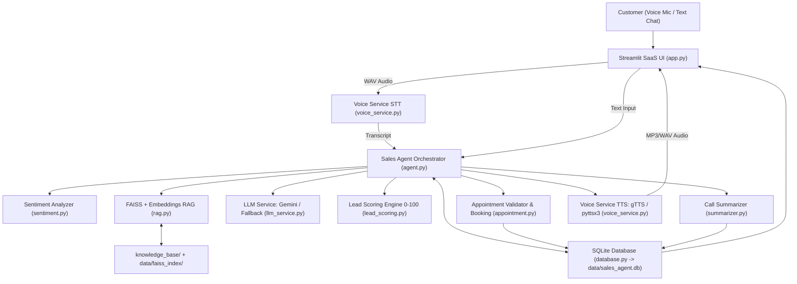

# Autonomous AI Sales Voice Agent (`Fortivex VoiceCRM MVP`)

A modular, end-to-end **Autonomous AI Sales Voice Agent & CRM Dashboard** built in Python and Streamlit. It handles inbound/outbound-style customer sales conversations via voice (STT/TTS) or text chat, maintains contextual session memory, retrieves grounded answers from company documents via FAISS RAG, analyzes customer sentiment in real time, scores and qualifies leads (0–100), books validated simulated demo appointments in SQLite, and generates post-call summaries.

> **Simulation Notice:** Sample CRM leads, appointments, and calendar bookings in this MVP are simulated and persisted locally in SQLite (`data/sales_agent.db`) for demonstration purposes—no external calendar or live third-party CRM API is mutated.

---

## 1. System Architecture



---

## 2. Project Structure

```text
ai-sales-voice-agent/
├── app.py                     # 6-page Streamlit SaaS dashboard & voice/chat UI
├── agent.py                   # End-to-end conversational sales agent orchestrator
├── llm_service.py             # Gemini API integration + deterministic offline fallback
├── voice_service.py           # Speech-to-Text (SpeechRecognition) & TTS (gTTS/pyttsx3)
├── lead_scoring.py            # Explainable 0-100 lead scoring & Hot/Warm/Cold classification
├── sentiment.py               # Real-time sentiment classifier & tone guidance
├── rag.py                     # Document chunking, sentence-transformers/TF-IDF + FAISS RAG
├── database.py                # SQLite schema, CRUD operations, and demo data seeding
├── appointment.py             # Date/time parsing, business-hour & conflict validation
├── summarizer.py              # Structured post-call summary generation
├── requirements.txt           # Python dependencies
├── .env.example               # Environment variables template
├── REPORT.md                  # 1-page project report for technical evaluation
├── docs/
│   └── TECHNICAL_DESIGN.md    # Architecture, RAG, scoring, 100k scalability, security & cost
├── knowledge_base/
│   ├── fortivex_product_catalog.md
│   └── fortivex_enterprise_security_faq.md
└── tests/
    └── test_end_to_end.py     # Automated workflow & module verification tests
```

---

## 3. Windows Setup & Execution Instructions

### Prerequisites
- Python 3.10+ (tested on Python 3.14 on Windows)
- Internet access for Google Gemini API / Google Speech Recognition / gTTS (the app also runs in **Offline Fallback Mode** if APIs are unavailable)

### Step 1: Create & Activate Virtual Environment (Optional if using system Python)
```powershell
cd C:\Users\HP\.gemini\antigravity\scratch\ai-sales-voice-agent
python -m venv .venv
.\.venv\Scripts\Activate.ps1
```

### Step 2: Install Dependencies
```powershell
pip install -r requirements.txt
```

### Step 3: Configure Environment Variables
```powershell
copy .env.example .env
```
Open `.env` and add your `GEMINI_API_KEY` (if left blank, the app automatically runs in **Local Intelligent Fallback Mode** so every workflow still functions).

### Step 4: Run the Application
```powershell
streamlit run app.py
```
The SQLite database (`data/sales_agent.db`) and FAISS vector index (`data/faiss_index/`) are created and seeded automatically on first launch.

### Step 5: Run Automated Tests
```powershell
pytest -v
```

---

## 4. End-to-End Demo Workflow
1. Open **AI Sales Agent** in the sidebar.
2. Speak into the microphone widget (or type / click the Quick Demo buttons).
3. Ask about pricing/plans (e.g., *"Hi, I'm Ananya from Zenith Health. We need an English & Hindi voice agent for 3,000 calls/month. What plans do you offer?"*) — observe **RAG sources** and **sentiment**.
4. Share budget, timeline, and contact info — observe **Contextual Memory** and **Lead Score (0–100)** update live.
5. Request a demo slot (e.g., *"Book a demo tomorrow at 3:00 PM"*) — observe validated **Simulated Appointment Confirmation**.
6. Click **End Call & Generate Summary** — view the structured summary and verify updates across **Home Dashboard**, **Lead Management**, **Appointments**, and **Call Analytics**.
