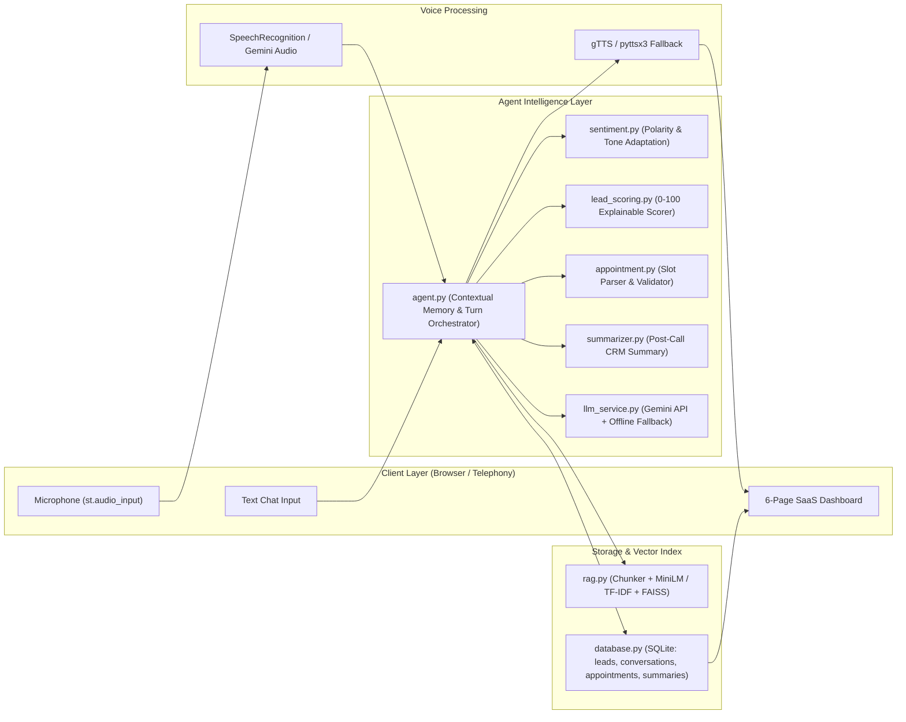

# Technical Design, Scalability & Security Document

## 1. System Architecture Diagram

---

## 2. Technologies Used & Design Rationale

| Layer | Technology | Rationale |
|---|---|---|
| **UI / SaaS Frontend** | Streamlit + Plotly + Pandas | Rapid, clean, interactive SaaS dashboard with built-in `st.audio_input` for Windows browser mic capture without PyAudio compilation issues. |
| **LLM Engine** | Google Gemini (`google-genai`) + Offline Fallback | Low-latency reasoning, structured JSON entity extraction, and multilingual responses; offline fallback ensures 100% demo reliability. |
| **Voice (STT / TTS)** | `SpeechRecognition` + `gTTS` (+ `pyttsx3` fallback) | Free, zero-setup on Windows, supports multiple languages (`en`, `hi`, `ta`, `te`, `es`, `fr`, `de`). |
| **RAG Pipeline** | `sentence-transformers` (`all-MiniLM-L6-v2`) + `FAISS` (`IndexFlatIP`) | Fast local semantic vector search with L2-normalized cosine similarity and automatic TF-IDF fallback when offline. |
| **Database** | SQLite (`data/sales_agent.db`) | Zero-config ACID-compliant relational persistence across leads, transcripts, appointments, summaries, and knowledge docs. |

---

## 3. Lead-Scoring Algorithm (0–100)

The `lead_scoring.py` module computes a deterministic, auditable 0–100 score across five weighted dimensions:

| Dimension | Max Points | Scoring Criteria |
|---|---|---|
| **Budget Clarity & Fit** | **25** | Enterprise ($1,500+/mo) = 25; Growth ($500+/mo) = 22; Starter ($150+/mo) = 16; Lower = 10; Unspecified/Exploring = 3–8. |
| **Purchase Timeline** | **25** | Immediate/This month/2 weeks = 25; Next month = 20; Next quarter (1–3 mo) = 14; 6+ months/Researching = 5; Missing = 0. |
| **Requirements & Product Fit** | **20** | Identified product tier (+8) + detailed use-case requirements (+4 to +12 based on specificity). |
| **Contact Completeness** | **15** | Full name (+5), valid email (+5), phone number (+5). |
| **Engagement & Sentiment** | **15** | Positive sentiment (+8) / Neutral (+5) / Negative (+2) + conversation depth (+2 to +4) + confirmed demo booking (+3). |

**Lead Categorization:**
- **Hot Lead:** `score >= 70` (Immediate sales follow-up / demo priority)
- **Warm Lead:** `40 <= score < 70` (Consultative nurturing & sandbox pilot)
- **Cold Lead:** `score < 40` (Long-term automated drip campaigns)

---

## 4. RAG Pipeline (`rag.py`)

1. **Ingestion:** Supports `.md`, `.txt`, `.pdf` (via `pypdf`), `.csv`, and `.json`.
2. **Semantic Chunking:** Splits documents on paragraph boundaries (`chunk_size=500`, `overlap=90`), falling back to sentence boundaries for long paragraphs.
3. **Embedding & Normalization:** Encodes chunks using `all-MiniLM-L6-v2` (384-dim) with L2 normalization (`normalize_embeddings=True`). If the model is unavailable offline, falls back to L2-normalized `TfidfVectorizer`.
4. **FAISS Indexing & Persistence:** Stores embeddings in `faiss.IndexFlatIP` (exact inner product = cosine similarity on unit vectors) and persists `kb.faiss` + `chunks.json` under `data/faiss_index/`.
5. **Grounded Generation:** Top-4 chunks are injected into the LLM system prompt with strict anti-hallucination rules so prices and policies are never fabricated.

---

## 5. Scalability Strategy (Supporting up to 100,000 Users)

To scale from this local single-user MVP to **100,000 concurrent/monthly users**:

1. **Decoupled Microservices Architecture:**
   - Replace Streamlit monolith with **Next.js (React)** frontend + **FastAPI** stateless async API/WebSocket workers behind **AWS ALB / CloudFront** or **NGINX**.
2. **Real-Time Low-Latency Voice Streaming (<500ms):**
   - Replace turn-based WAV recording with **WebRTC / LiveKit / Twilio Media Streams** over WebSockets.
   - Stream audio frames to **Deepgram Nova-2** (streaming STT) -> **Gemini Flash / vLLM** (token streaming) -> **ElevenLabs Turbo / Cartesia** (streaming TTS with barge-in interruption handling).
3. **Database & State Scaling:**
   - **Redis Cluster:** Sub-10ms session memory, rate limiting, and distributed locks for appointment slots.
   - **PostgreSQL (Multi-Tenant with Read Replicas):** Partitioned by `tenant_id` with connection pooling (`PgBouncer`).
   - **Managed Vector DB (Qdrant / pgvector / Pinecone):** Namespace-isolated per tenant for multi-million-chunk RAG retrieval.
4. **Asynchronous Workers:**
   - Offload post-call summarization, CRM webhook sync (HubSpot/Salesforce/Zoho), and PDF indexing to **Celery / Kafka** worker queues.
5. **Auto-Scaling:**
   - Kubernetes (**EKS / GKE**) with Horizontal Pod Autoscaler (HPA) scaling on CPU, WebSocket concurrency, and queue depth across multi-AZ deployments.

---

## 6. Security, Deployment & Infrastructure Cost Estimates

### Security Controls
- **Secrets Management:** API keys stored in `.env` locally; AWS Secrets Manager / GCP Secret Manager in production.
- **Data Protection:** TLS 1.3 in transit, AES-256 at rest, tenant-scoped queries (`WHERE tenant_id = ?`), and PII redaction before external LLM calls.
- **AI Guardrails:** Prompt-injection filtering, strict RAG grounding, and role-based access control (RBAC) on admin/CRM endpoints.

### Estimated Monthly Infrastructure & API Costs (100k MAU / ~250k voice minutes/month)
- **Compute (EKS Kubernetes API + Voice Workers + Redis):** ~$1,200 – $1,800/mo
- **Managed PostgreSQL + Vector DB (Qdrant/pgvector) + S3 Storage:** ~$450 – $700/mo
- **LLM Inference (Gemini Flash tiered routing):** ~$400 – $650/mo
- **Streaming STT + TTS + Telephony (at enterprise volume ~$0.025–$0.04/min):** ~$6,250 – $9,500/mo
- **Total Operating Cost:** ~$8,300 – $12,650/mo (~$0.08–$0.13 per active user/month), well covered by SaaS plans ($199–$1,999+/mo).

---

## 7. Limitations & Future Enhancements

### Current MVP Limitations
- **Turn-based Voice Input:** Uses Streamlit's `st.audio_input` (record-then-send) rather than full-duplex WebRTC streaming with mid-sentence barge-in.
- **Simulated CRM & Calendar:** Appointments and leads are persisted locally in SQLite rather than syncing live with Google Calendar, HubSpot, or Twilio PSTN trunks.
- **Single-User Local DB:** SQLite suits local demos and small workloads, not multi-region concurrent writes at 100k scale.

### Future Enhancements
1. Full-duplex **WebRTC + SIP telephony** integration (Twilio/Exotel) with <500ms voice-to-voice latency.
2. **OAuth2 CRM & Calendar Connectors** (Google Calendar, Zoho CRM, HubSpot, Salesforce).
3. **Outbound Campaign Dialer** with automated DND compliance and scheduled follow-up calls.
4. **Automated Eval & Guardrail Dashboard** tracking hallucination rates, latency percentiles (p95), and conversion lift.
